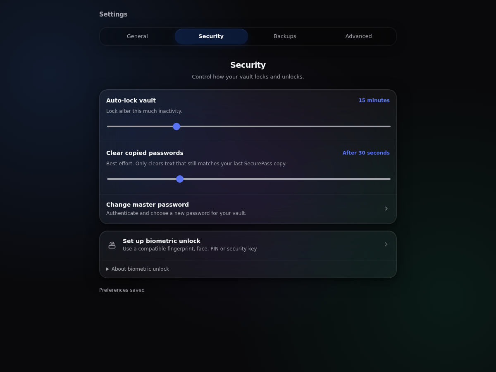
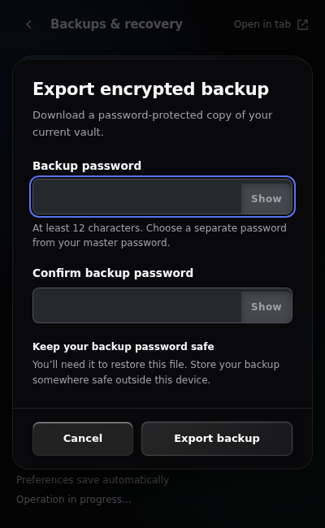
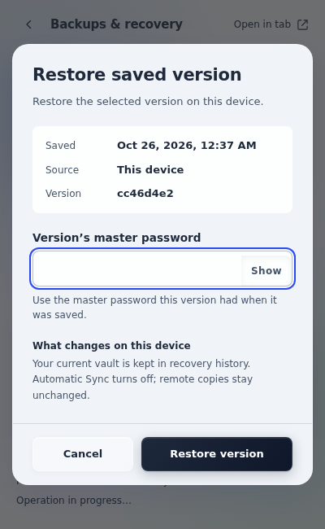

<div align="center">
  

  <h1>SecurePass</h1>

  <p><strong>Gera palavras-passe. Organiza credenciais. Protege o teu cofre no browser.</strong></p>

  <p>Uma extensão para Google Chrome com cofre local cifrado, preenchimento assistido<br>e ferramentas para avaliar e gerir palavras-passe.</p>

  <p>
    
    
    
    <a href="LICENSE"></a>
  </p>

  <p>
    <a href="#funcionalidades">Funcionalidades</a> ·
    <a href="#instalação">Instalação</a> ·
    <a href="#primeiros-passos">Primeiros passos</a> ·
    <a href="#desenvolvimento">Desenvolvimento</a> ·
    <a href="SECURITY.md">Modelo de segurança</a>
  </p>
</div>

## Visão geral

O SecurePass reúne geração de palavras-passe, análise e gestão de credenciais numa extensão com armazenamento local cifrado. O cofre e o gerador funcionam sem ligação à rede; a consulta de fugas de dados e a sincronização são opcionais.

O projeto utiliza **JavaScript com módulos ES**, APIs nativas do browser e **Manifest V3**. A extensão pode ser executada diretamente a partir do código-fonte, sem compilação nem dependências de execução.

> **Estado do projeto:** versão 0.2.0 em desenvolvimento, com testes automatizados e limitações conhecidas em sincronização e recuperação. A validação para distribuição e a auditoria de segurança independente continuam pendentes. Consulta o [registo de validação](docs/VALIDATION.md) antes de depender do projeto para dados importantes.

## Interface

Gestão do cofre e das definições no popup ou num separador dedicado, com temas claro, escuro e do sistema. A interface atual está em inglês.

<p align="center">
  
</p>

<details>
  <summary>Ver os diálogos de exportação e restauro</summary>

  <p>Fluxos guiados para criar backups cifrados e rever os efeitos do restauro de uma versão anterior.</p>

  <p align="center">
    
    
  </p>

  <p>As capturas utilizam perfis descartáveis e dados fictícios.</p>
</details>

## Funcionalidades

| Funcionalidade | O que permite fazer |
| --- | --- |
| **Cofre local cifrado** | Criar, pesquisar, adicionar, editar e remover credenciais, alterar a palavra-passe mestra e bloquear o acesso. |
| **Gerador configurável** | Definir comprimento, conjuntos de caracteres e exclusões, com suporte para um subconjunto de regras dos formulários. Regras impossíveis ou não suportadas geram um erro explícito. |
| **Análise de palavras-passe** | Obter uma avaliação heurística local e consultar, por pedido explícito, ocorrências no Have I Been Pwned. |
| **Preenchimento assistido** | Selecionar uma conta numa janela da extensão e autorizar o preenchimento no site correspondente, sem submeter automaticamente o formulário. |
| **Sugestões de gravação** | Rever e confirmar a gravação ou atualização de credenciais detetadas na submissão de um formulário. |
| **Backups e recuperação** | Exportar ficheiros cifrados, pré-visualizar importações, resolver duplicados e restaurar versões anteriores. |
| **Bloqueio automático** | Bloquear o cofre por inatividade, ao bloquear o sistema operativo ou ao fechar a última janela do browser. |
| **Desbloqueio com WebAuthn/PRF** | Usar um autenticador compatível, com verificação por biometria, PIN ou chave de segurança, conforme o dispositivo. |
| **Personalização** | Ajustar tema, tempo de bloqueio e limpeza da área de transferência no popup ou no separador de gestão. |

A compatibilidade com Chrome Sync está disponível nas opções avançadas, com resolução explícita de conflitos e limitações de capacidade. Consulta [Sincronização e estado atual](#sincronização-e-estado-atual).

## Instalação

**Requisito:** Google Chrome 122 ou superior. Para experimentar a extensão, não precisas de instalar Node.js nem executar comandos de compilação.

1. Obtém o projeto por **Code → Download ZIP** no GitHub e extrai o arquivo, ou clona o repositório:

   ```sh
   git clone https://github.com/JoaoAlves05/SecurePass.git
   cd SecurePass
   ```

2. Abre `chrome://extensions` no Chrome.
3. Ativa o **Modo de programador** (*Developer mode*).
4. Seleciona **Carregar expandida** (*Load unpacked*) e escolhe a pasta que contém o `manifest.json`.
5. Fixa o SecurePass na barra de ferramentas e abre a extensão.

Após alterações ao código, recarrega a extensão em `chrome://extensions` e atualiza as páginas afetadas.

## Primeiros passos

1. **Cria um cofre** com uma palavra-passe mestra de, pelo menos, 16 caracteres. Também podes importar um backup cifrado para um perfil vazio.
2. **Adiciona credenciais** e utiliza o gerador para criar palavras-passe com as regras pretendidas.
3. **Configura o bloqueio automático** e, se tiveres um autenticador com suporte PRF, o desbloqueio com WebAuthn.
4. **Preenche uma conta num site** através da seleção e confirmação apresentadas pela extensão. Confirma que o site aceitou os dados antes de aprovar uma sugestão de gravação.
5. **Exporta um backup cifrado** e verifica o restauro com dados descartáveis antes de depender desse processo.

A palavra-passe mestra é preservada exatamente, incluindo espaços, símbolos e Unicode. Palavras-passe de cofres antigos continuam a ser aceites no desbloqueio e na migração.

**Não existe recuperação por servidor.** Perder a palavra-passe mestra e o acesso a um autenticador PRF configurado pode tornar o cofre inacessível. Um backup também exige a palavra-passe que o protege.

## Segurança e privacidade

O SecurePass utiliza a **Web Crypto API** para cifrar os dados antes de os guardar. No formato atual do cofre:

- **AES-256-GCM** cifra as credenciais e protege a chave de dados.
- **PBKDF2-SHA-256**, com 600 000 iterações e salt aleatório, deriva a chave de proteção a partir da palavra-passe mestra.
- A palavra-passe mestra não é guardada. Enquanto o cofre está desbloqueado, a chave de dados permanece em `chrome.storage.session`, com acesso restrito aos contextos da extensão.
- A sessão pode sobreviver à suspensão normal do service worker; reiniciar o browser ou recarregar a extensão termina o desbloqueio.
- O preenchimento exige correspondência exata de protocolo, hostname e porta, além de autorização para o documento original.

A consulta opcional ao Have I Been Pwned envia apenas os primeiros cinco caracteres do hash SHA-1 da palavra-passe, com padding na resposta. A palavra-passe e o hash completo não são enviados. A avaliação local é heurística; uma consulta sem ocorrências não garante que a palavra-passe seja segura.

A limpeza da área de transferência tenta apagar apenas conteúdo que ainda corresponda à última cópia feita pelo SecurePass. O prazo depende do browser e do sistema operativo e não é garantido.

Consulta [SECURITY.md](SECURITY.md) para o modelo de ameaça e os limites de proteção. Um dispositivo comprometido enquanto o cofre está desbloqueado permanece fora das garantias de proteção.

<details>
  <summary>Permissões da extensão</summary>

| Permissão ou acesso | Finalidade |
| --- | --- |
| `storage` | Preferências locais, estado de sessão e registos cifrados de sincronização. |
| `activeTab` | Sugerir o site atual quando abres o popup. |
| `alarms` e `idle` | Gerir prazos da sessão, bloqueio do sistema e expiração de sugestões. |
| `offscreen` | Executar operações da área de transferência independentemente do popup. |
| `clipboardWrite` e `clipboardRead` | Copiar e verificar se o conteúdo ainda pertence à extensão antes da limpeza. |
| `api.pwnedpasswords.com` | Consultar fugas de dados após um pedido explícito. |
| Scripts em páginas HTTP/HTTPS | Detetar campos e preencher uma credencial após autorização. |

</details>

## Backups e recuperação

Os backups normais são ficheiros JSON cifrados com uma palavra-passe própria de, pelo menos, **12 caracteres**. A importação apresenta entradas novas, idênticas e em conflito, com opções para manter ambas, ignorar ou substituir.

O projeto conserva até **cinco versões locais anteriores** e um arquivo local de até **20 registos remotos**. As cópias de recuperação são exportadas individualmente; arquivos agregados antigos de grande dimensão ainda exigem o leitor de migração previsto no plano.

Restaurar uma versão anterior aplica-a localmente e desativa a sincronização. Alterar a palavra-passe mestra protege o cofre atual com uma nova chave e revoga a configuração biométrica local; backups e versões históricas mantêm as palavras-passe que os protegiam.

**Mantém backups cifrados independentes da sincronização.** Apagar este dispositivo remove os dados locais, incluindo o histórico, mas deixa as cópias remotas. Não existe um fluxo implementado para apagar todos os dispositivos.

## Sincronização e estado atual

O cofre local em IndexedDB é a referência para as operações normais. Quando a sincronização está ativa, as alterações de credenciais são primeiro gravadas localmente e depois publicadas como versões cifradas. Uma falha de publicação fica assinalada como pendente.

| Área | Estado atual |
| --- | --- |
| **Cofre local, gerador e análise** | Implementados, com cobertura automatizada descrita no registo de validação. |
| **Backups e recuperação local** | Implementados; a migração de grandes arquivos antigos continua pendente. |
| **Chrome Sync** | Transporte legado com resolução explícita de conflitos. As quotas podem impedir novas publicações, mesmo quando uma versão inicial cabe no armazenamento. |
| **Google Drive** | Planeado e indisponível na versão atual. OAuth e o novo protocolo de sincronização e autorização de dispositivos ainda não estão implementados. |
| **Validação para distribuição** | Pendente: inclui autenticadores físicos, transporte autenticado Google e cenários de falha e recuperação entre dispositivos. |

Os testes de sincronização utilizam transporte emulado entre dois perfis Chromium; os testes de PRF utilizam um autenticador virtual. Estes resultados não demonstram compatibilidade com todo o hardware nem com o transporte Google autenticado.

O estado detalhado está na [revisão de settings, Sync e dados](docs/REVIEW_SETTINGS_SYNC_DATA.md), nas [correções locais implementadas](docs/SETTINGS_UX_IMPLEMENTATION.md) e na [revisão de backups e opções avançadas](docs/REVIEW_BACKUP_ADVANCED.md). O [plano de evolução](docs/SYNC_DATA_PLAN.md) descreve propostas ainda por implementar e validar.

## Compatibilidade e limites

- **Browser:** Chrome 122 ou superior. Incógnito, URLs `file://`, iframes e campos dentro de Shadow DOM não fazem parte do suporte atual.
- **Capacidade local:** até 5 000 entradas e 3 MiB de JSON de credenciais, respeitando ambos os limites. A capacidade do Chrome Sync é inferior e independente.
- **Importação:** até 16 MiB por ficheiro, com validação do tamanho final do cofre.
- **WebAuthn/PRF:** exige um autenticador compatível. Quando não está disponível, utiliza a palavra-passe mestra.

## Desenvolvimento

Para os testes e ferramentas, utiliza **Node.js 18 ou superior** e npm. O empacotamento em ZIP requer também **Python 3**.

```sh
npm ci
npm run check
npm test
```

Para os cenários de browser, instala primeiro o Chromium utilizado pelo Playwright:

```sh
npx playwright install chromium
npm run test:browser
npm run test:settings-browser
npm run test:backup-dialogs-browser
npm run test:sync-browser
```

| Comando | Finalidade |
| --- | --- |
| `npm run check` | Verificar sintaxe, imports, ciclos e consistência das versões. |
| `npm test` | Executar regressões Node com Web Crypto, Chrome simulado e IndexedDB de teste. |
| `npm run test:browser` | Exercitar a extensão no Chromium, incluindo isolamento, autofill, clipboard e PRF virtual. |
| `npm run test:settings-browser` | Validar percursos de definições e gestão de dados. |
| `npm run test:backup-dialogs-browser` | Validar os diálogos de backup e restauro. |
| `npm run test:sync-browser` | Exercitar sincronização com dois perfis e transporte emulado. |
| `npm run package` | Gerar `dist/SecurePass-0.2.0.zip` com os ficheiros de execução e a documentação de segurança/licença. |

Os testes utilizam dados fictícios e perfis descartáveis; alguns atualizam capturas em `docs/screenshots/`. Os resultados executados e a aceitação pendente estão em [docs/VALIDATION.md](docs/VALIDATION.md). Criar o ZIP não constitui validação para distribuição.

### Estrutura do projeto

```text
SecurePass/
├── manifest.json       # Entradas, permissões e configuração Manifest V3
├── background/         # Service worker e encaminhamento de mensagens
├── src/                # Cofre, criptografia, geração, validação e armazenamento
├── popup/              # Interface, definições e módulos de gestão
├── content/            # Integração com formulários e ferramentas nas páginas
├── auth/               # Confirmação e autenticação em janelas da extensão
├── offscreen.html      # Documento de apoio à área de transferência
├── offscreen.js        # Operações da área de transferência
├── tests/              # Regressões Node e cenários Playwright
├── scripts/            # Verificações e empacotamento
├── docs/               # Revisões, planos, evidências e capturas
└── icons/              # Ícones da extensão
```

Consulta [ARCHITECTURE.md](ARCHITECTURE.md) para as responsabilidades dos módulos e os fluxos de dados, e [AGENTS.md](AGENTS.md) para as convenções do repositório.

## Contribuir

Sugestões, correções e melhorias são bem-vindas. Antes de uma alteração significativa, abre uma [issue](https://github.com/JoaoAlves05/SecurePass/issues) para discutir o objetivo e o impacto.

1. Cria uma branch descritiva, por exemplo `feature/minha-melhoria`.
2. Mantém a alteração focada e acrescenta regressões relevantes para integridade, concorrência, recuperação ou segurança.
3. Executa as verificações adequadas e `git diff --check`.
4. Abre um pull request com o motivo da alteração, a validação realizada e capturas quando houver alterações visuais.

Nunca incluas credenciais reais, palavras-passe mestras ou exportações de cofres em commits, issues ou testes.

## Licença

Distribuído sob a [licença MIT](LICENSE).
