# Settings UX — journeys, screens and acceptance map

Design baseline 2026-10-25, linked to [the complete plan](SYNC_DATA_PLAN.md) and [local issue](issues/SETTINGS_UX.md). This is the interaction contract, not a statement that every SC is implemented. Google OAuth is not configured; Drive enrollment, signed-device protocol and recovery-kit paths must remain unavailable until their prerequisites are implemented and verified.

## Information architecture

A full management tab uses the same bundled trusted page as the popup, with `?manage=1`. Preserve visual identity and light/dark/system themes. Keep credentials out of status cards and diagnostics. The popup offers a compact summary and “Open management”. The management navigation contains Overview, Sync, Backups & recovery, Security, Preferences and Danger zone. Advanced legacy transport maintenance is collapsed and explicitly labelled.

| Screen | Purpose | Primary action / exit | Error and cancellation contract |
|---|---|---|---|
| U01 — Welcome / connect | Create locally, restore backup, or connect existing vault | Create / choose file; Drive unavailable with reason | Wrong remote password never creates; unknown remote is not empty. |
| U02 — Unlock / key change | Authenticate the selected vault or historical snapshot | Continue, reveal password, cancel | No implicit password changes; unavailable kit/device features explain prerequisites. |
| U03 — Versions / conflict review | Choose remote candidate and destination; review effects | Restore locally or merge into unlocked local vault | Remote selection captured before password; preserve unselected heads and destination key. |
| U04 — Sync overview | Separate local state, transport, pending work and remote inspection | Explicit check, retry only when enabled | No automatic remote reads while off; failed check retains local recovery access. |
| U05 — Backup wizard | Read bounded file, authenticate source, preview conflict counts, choose strategy | Review → confirm import/create | Preview bound to input digest and destination revision; wrong password makes no writes. |
| U06 — Recovery history | Stable snapshot list, historical password, local restore | Select → review → restore locally | Reordered list never restores another snapshot; remote remains untouched. |
| U07 — Danger zone | Clear entries, erase device, clear extra archive | Scope-specific confirmation and reauthentication | Corrupt local data can be erased explicitly; remote deletion not offered as implemented. |
| U08 — Preferences / operation dialog | Versioned settings, immediate deadline, one accessible operation | Save changes; cancel dialog | Dialog exclusivity, inline errors, focus restoration and no stale rollback. |

## Screen sketches

```text
┌ SecurePass · Settings & data ─────────── Open management ↗ ┐
│ Your vault                                              │
│ Saved on this device · Locked / Unlocked                 │
│ [Create / Unlock]   [Export backup]                      │
├ Sync ───────────────────────────────────────────────────┤
│ Google Drive                      Setup not available   │
│ Configure Google OAuth before connecting an account.    │
│ Legacy Chrome Sync: Off / Pending / Needs attention      │
│ [Check existing versions]       [Advanced maintenance ▾] │
├ Backups & recovery ──────────────────────────────────────┤
│ [Export encrypted backup]  [Import or restore]            │
│ Local snapshots · date · revision · [Restore] [Export]    │
├ Security & preferences ──────────────────────────────────┤
│ Master password · Device biometric unlock · Auto-lock    │
├ Danger zone ─────────────────────────────────────────────┤
│ Clear current entries        Erase only this device     │
└─────────────────────────────────────────────────────────┘
```

```text
Import backup          1 File → 2 Unlock → 3 Review → 4 Done
Source: encrypted backup       Destination: this device
12 new · 3 identical · 2 conflicting accounts
Conflict policy: [Keep both / Skip / Replace]
If destination changed: “Vault changed. Review again.”
[Cancel]                                [Confirm import]
```

```text
Restore a snapshot                       Local operation
Snapshot: 25 Oct, 10:42 · revision 1234abcd
Current vault is preserved in recovery history.
Sync will be turned off on this device. Remote copies stay.
[Historical master password · show]
[Cancel]                               [Restore locally]
```

## Journey state machine

```mermaid
stateDiagram-v2
  [*] --> Overview
  Overview --> SelectSource: import / recover / remote versions
  SelectSource --> Authenticate: selected stable identity
  Authenticate --> Authenticate: wrong password (no writes)
  Authenticate --> Review: content validated
  Review --> Review: destination changed; preview invalidated
  Review --> Commit: explicit confirmation
  Commit --> Complete: durable local commit
  Commit --> Attention: partial external operation
  Attention --> Review: reconcile actual state
  Complete --> Overview: refresh all state
  SelectSource --> Overview: cancel
  Authenticate --> Overview: cancel / lock
  Review --> Overview: cancel / lock
```



## Interaction rules

1. No `window.prompt()`/`confirm()` in Sync/data/settings workflows. Use one modal operation surface with a clear title, effects, labelled inputs/options, inline error, cancel and a specific confirmation button.
2. Capture revision/account/snapshot identity before opening any password dialog. Background validates again; a disabled button is not authorization.
3. One incompatible UI operation at a time; lock/close cancels pending secret entry and clears DOM values. Do not cancel an unrelated completed write or falsely report network rollback.
4. Errors remain in context and preserve non-secret choices. Never automatically create after wrong password or failed discovery. Passwords are not kept for retry.
5. Operations communicate “saved locally”, “publication pending”, “published to transport” distinctly. Off mode never says all devices are up to date.
6. Focus starts in the operation, stays within it, returns to the triggering control, and Escape equals Cancel. Announce status/errors with appropriate live regions. Do not reveal secrets by default.
7. Scope labels differentiate local restore, synchronized clear, local wipe and unavailable global deletion. Keep advanced version/compaction details outside the normal path.
8. New Drive/auth/recovery-kit features have truthful availability states; never use a simulated success in the production UI.

## SC01–SC58 traceability

“Design” means mapped to a screen/contract, not passed. Implementation evidence is recorded separately after running tests. Several SC are release gates outside the first local implementation (OAuth, signed protocol, hardware and independent review).

| Scenario | Screen | Expected outcome from plan | Design status |
|---|---|---|---|
| SC01 — Criar offline no primeiro dispositivo | U01 | Cofre local válido; Sync não é pré-requisito. | Designed; acceptance pending |
| SC02 — Criar com passwords de confirmação diferentes | U01 | Não criar; permitir correção sem perder contexto não sensível. | Designed; acceptance pending |
| SC03 — Segundo dispositivo, conta/cofre/password corretos | U01 | Desbloqueio e inscrição verificáveis; mesma identidade/época. | Designed; acceptance pending |
| SC04 — Segundo dispositivo, password errada | U01 | Nenhuma criação, escrita ou substituição; tentativas limitadas localmente. | Designed; acceptance pending |
| SC05 — Password correta mas dados adulterados | U01 | Rejeitar; não atribuir automaticamente a culpa à password. | Designed; acceptance pending |
| SC06 — Conta Google errada | U01 | Mostrar identidade e permitir mudar; não recriar o cofre conhecido. | Designed; acceptance pending |
| SC07 — Sem rede/erro ao descobrir | U01 | Estado desconhecido, nunca “cofre vazio”. | Designed; acceptance pending |
| SC08 — Nenhum cofre após listagem completa | U01 | Criação apenas explícita; alternativa de backup/conta. | Designed; acceptance pending |
| SC09 — Dois primeiros dispositivos criam ao mesmo tempo | U01 | Duas identidades conservadas; seleção explícita. | Designed; acceptance pending |
| SC10 — Local e remoto diferentes, passwords diferentes | U01 | Autenticar ambos para merge; preservar destino e origens. | Designed; acceptance pending |
| SC11 — Password igual em dois cofres distintos | U01 | Não confundir identidades nem juntar automaticamente. | Designed; acceptance pending |
| SC12 — Cancelar/desligar/fechar a meio do onboarding | U01 | Sem vínculo parcial de escrita; staging seguro e retoma clara. | Designed; acceptance pending |
| SC13 — Vários cofres ou vários heads no catálogo | U01 | Enumerar/selecionar; nenhuma escolha por data/nome. | Designed; acceptance pending |
| SC14 — Dispositivo conhecido usa password antiga após rotação | U02 | Preservar ramo antigo e pedir password atual para publicar. | Designed; acceptance pending |
| SC15 — Edições offline durante rotação noutro dispositivo | U02 | Rebase autenticado após novo desbloqueio; sem perda. | Designed; acceptance pending |
| SC16 — Duas rotações/administrações concorrentes | U02 | Conflito explícito, sem vencedor por relógio/contador isolado. | Designed; acceptance pending |
| SC17 — Falha em cada fase da rotação | U02 | Retoma da mesma operação; informar password/época efetivas. | Designed; acceptance pending |
| SC18 — Password esquecida, biometria/dispositivo acessível | U02 | Exportar dados com verificação; sem poderes administrativos implícitos. | Designed; acceptance pending |
| SC19 — Kit correto/errado/incompleto | U02 | Recuperar apenas com prova válida e dados disponíveis. | Designed; acceptance pending |
| SC20 — Sem qualquer password/chave/backup | U02 | Não conceder acesso; novo cofre independente só por escolha. | Designed; acceptance pending |
| SC21 — Kit roubado ou password comprometida | U02 | Procedimento de rotação e limites históricos comunicados. | Designed; acceptance pending |
| SC22 — Mudanças em entradas diferentes | U03 | Merge automático validado e convergente. | Designed; acceptance pending |
| SC23 — Mesma entrada muda em dois/três dispositivos | U03 | Conflito com manter ambas sem ultrapassar campos nem duplicar repetidamente. | Designed; acceptance pending |
| SC24 — Eliminar contra editar/criar offline antigo | U03 | Tombstone/conflito; nenhuma ressurreição silenciosa. | Designed; acceptance pending |
| SC25 — Dispositivo volta depois de checkpoint/90 dias | U03 | Trabalho preservado; rebase/seleção, sem escrita cega. | Designed; acceptance pending |
| SC26 — Retirar dispositivo e receber escrita desse autor | U02 | Rejeitar nova revisão; preservar dados antigos para exportação local. | Designed; acceptance pending |
| SC27 — Dispositivo novo sem fonte independente recebe história antiga válida | U02 | Não prometer frescura demonstrada; comparação/checkpoint quando disponíveis. | Designed; acceptance pending |
| SC28 — Upload termina no servidor mas resposta perde-se | U04 | Encontrar/verificar pelo ID lógico; sem duplicação funcional. | Designed; acceptance pending |
| SC29 — Falha local/remote em cada fronteira e restart do worker | U04 | Commit/outbox coerentes; sem falso rollback ou sucesso distribuído. | Designed; acceptance pending |
| SC30 — Ficheiro parcial/corrompido junto de versões válidas | U04 | Quarentena; local utilizável; sem compactar dependência incerta. | Designed; acceptance pending |
| SC31 — Quotas, 401, 403, 404, 429, 5xx e autorização revogada | U04 | Estado e retry corretos por motivo; sem loops de OAuth ou perda local. | Designed; acceptance pending |
| SC32 — Sync desligado por UI ou handler direto | U04 | Nenhum novo pedido remoto de escrita/limpeza/retry. | Designed; acceptance pending |
| SC33 — Desligar/mudar conta durante upload | U04 | Invalidar vínculo, informar resultado incerto e não transferir outbox. | Designed; acceptance pending |
| SC34 — Repetição, reordenação e três perfis | U03 | Mesmos resultados para mesmas decisões; conflitos não desaparecem. | Designed; acceptance pending |
| SC35 — Cofre, campos, UTF-8, ficheiros e KDF nos limites | U03 | Aceitar válidos; rejeitar excedidos antes de efeitos/uso descontrolado de recursos. | Designed; acceptance pending |
| SC36 — Backup exportado no limite e restauro em perfil novo | U05 | Round-trip exato sem Google; sem exigir cofre prévio. | Designed; acceptance pending |
| SC37 — Backup com password errada/versão desconhecida/JSON hostil | U05 | Erro controlado, sem alterar destino nem executar conteúdo. | Designed; acceptance pending |
| SC38 — Preview muda de origem/destino antes do commit | U05 | Invalidar/recalcular; nenhuma decisão aplicada a outra revisão. | Designed; acceptance pending |
| SC39 — Restaurar snapshot enquanto chegam novas gravações | U06 | Identidade estável; restaurar o selecionado ou pedir nova seleção. | Designed; acceptance pending |
| SC40 — Recovery legacy grande e exportação em lote nova | U05 | Memória/cancelamento limitados; todos os ficheiros novos reimportáveis. | Designed; acceptance pending |
| SC41 — Wipe com cofre corrompido, ausente e remoto indisponível | U07 | Eliminação local explícita possível; remoto preservado. | Designed; acceptance pending |
| SC42 — Eliminação remota interrompida e dispositivo offline regressa | U07 | Alcance/pendências claros; nenhuma promessa de apagamento físico global. | Designed; acceptance pending |
| SC43 — Compactação com novo ramo/upload/dispositivo antigo | U03 | Preservar heads/cópias necessárias e respeitar checkpoint. | Designed; acceptance pending |
| SC44 — Lock/auto-lock durante password, merge, export ou biometria | U02 | Cancelar texto em claro; nenhuma sessão reativada por operação velha. | Designed; acceptance pending |
| SC45 — Reduzir timeout, suspensão e restart | U08 | Prazo efetivo imediato; Sync/status não renovam atividade. | Designed; acceptance pending |
| SC46 — PRF ausente/cancelado, reinstalação e chave rodada | U02 | Password disponível; nova inscrição; sem bypass nem biometria transferida. | Designed; acceptance pending |
| SC47 — Assinatura, cadeia ou época forjadas; escritor revogado | U02 | Rejeitar antes de aplicar; nenhuma alteração de autoridade por metadados soltos. | Designed; acceptance pending |
| SC48 — Gravações de settings em corrida com Sync/dois separadores | U08 | Sem reverter vínculo; respostas/UI reconciliadas por revisão. | Designed; acceptance pending |
| SC49 — Settings inválidos, falha anterior e sucesso posterior | U08 | Reparação conservadora; reset/recuperação acessíveis; tema/gerador coerentes. | Designed; acceptance pending |
| SC50 — Restauro/clear/import alteram status | U08 | Toggle, contadores, seleção e botões refletem estado efetivo. | Designed; acceptance pending |
| SC51 — Duplo clique, vários diálogos, Escape, fecho e leitor de ecrã | U08 | Exclusão/cancelamento/foco previsíveis; sem promessas pendentes esquecidas. | Designed; acceptance pending |
| SC52 — Clipboard/cache HIBP durante lock/wipe/clear | U07 | Não apagar conteúdo alheio nem repovoar estado eliminado por pedido antigo. | Designed; acceptance pending |
| SC53 — Legacy e v2 coexistem; múltiplas passwords e heads | U06 | Inventário completo, autenticação separada e preservação das fontes. | Designed; acceptance pending |
| SC54 — Migração interrompida e dispositivo antigo publica depois | U06 | Retoma idempotente; alteração tardia não é ignorada nem aplicada silenciosamente. | Designed; acceptance pending |
| SC55 — Cliente antigo recebe versão nova e downgrade da extensão | U06 | Não gravar formato desconhecido; oferecer atualização/exportação compatível. | Designed; acceptance pending |
| SC56 — Tokens/segredos em logs, mensagens, export e content scripts | U08 | Ausência comprovada; apenas contextos de gestão autorizados. | Designed; acceptance pending |
| SC57 — Sessão Google perdida, dados remotos apagados ou disco cheio | U04 | Cofre acessível preservado; diagnóstico e backup/restauro independentes. | Designed; acceptance pending |
| SC58 — Identidade/fingerprint de cofre não corresponde à fonte confiável | U01 | Bloquear ligação/substituição até decisão verificada; não aceitar só pelo nome. | Designed; acceptance pending |

## Delivery evidence

See `docs/SETTINGS_UX_IMPLEMENTATION.md` for actual handlers, regression results and remaining gates. Screenshots must use disposable credentials and new filenames, preserving preexisting phase-1 fixtures.
